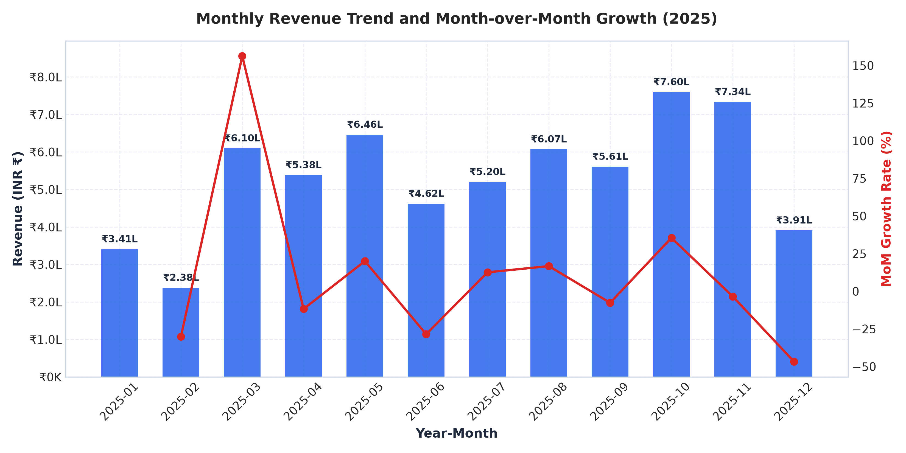
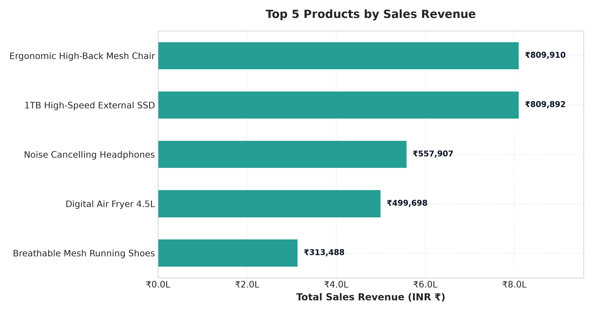
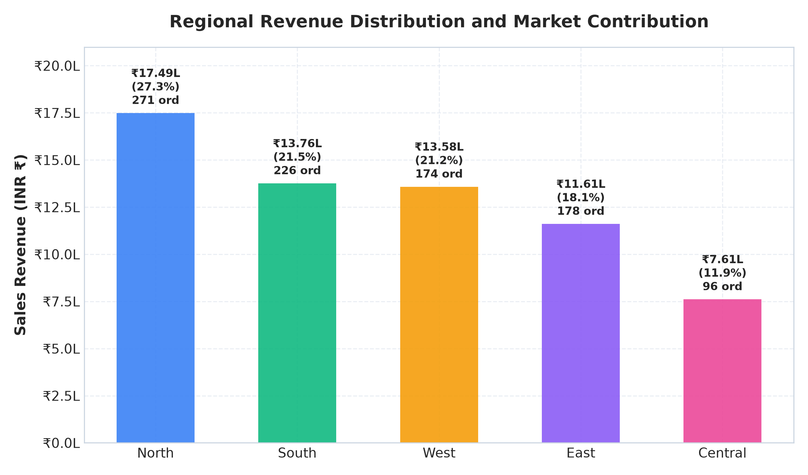
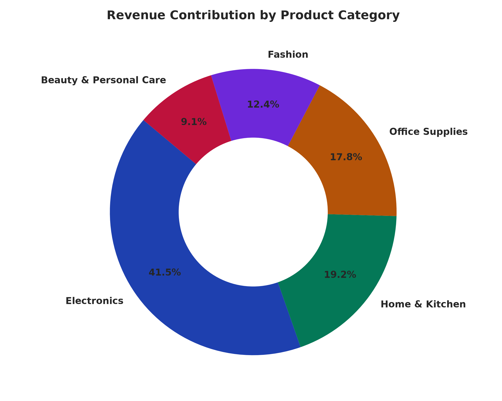

# Retail Sales Analysis Dashboard

[](https://www.python.org/)
[](https://www.sqlite.org/)
[](https://powerbi.microsoft.com/)
[](https://www.microsoft.com/excel)
[](https://docs.pytest.org/)
[](LICENSE)

An enterprise-ready, end-to-end data analytics and business intelligence portfolio project demonstrating practical expertise in **Python, SQL, Excel, and Power BI**. 

This repository analyzes transactional retail sales across multiple product lines, geographic territories, and seasons, delivering executive KPIs, consumer basket size patterns, and actionable commercial recommendations.

---

## 📌 Project Overview & Business Problem

Retail businesses face mounting challenges managing multi-channel product portfolios, optimizing seasonal inventory, and identifying underperforming sales territories. Without unified data cleaning and business intelligence, leadership faces:
- Inaccurate revenue accounting due to missing transaction amounts or duplicate syncs.
- Difficulty distinguishing multi-item shopping carts from duplicate entries.
- Unclear month-over-month seasonality and holiday demand surges.
- Sub-optimal regional inventory staging and stockout risks.

### Business Objectives:
1. **Automate Data Hygiene:** Construct a robust Python pipeline that sanitizes raw feeds, reconciles missing transaction amounts, standardizes dimensions, and logs every audit step without dropping legitimate multi-item orders.
2. **Derive Core Financial & Operational KPIs:** Calculate Total Revenue, Unique Order Volume, Average Order Value (AOV), Physical Units Sold, and SKU Performance.
3. **Model & Query in Relational SQL:** Load cleaned datasets into an indexed SQLite database and execute ANSI SQL analytical queries using CTEs and window functions (`LAG()`).
4. **Build an Interactive Power BI Dashboard:** Provide a complete data model, calendar dimension, DAX measure suite, and dashboard build guide.
5. **Reconcile Across Platforms:** Ensure 100% mathematical consistency across Python, SQL, Excel PivotTables, and Power BI.

---

## 🛠️ Technology Stack

| Technology | Purpose | Key Libraries / Modules |
| :--- | :--- | :--- |
| **Python** | Data cleaning, validation, and analytics | `pandas`, `numpy`, `openpyxl` |
| **Visualizations** | High-resolution publication charts | `matplotlib`, `altair` |
| **SQL (SQLite)** | Relational database schema, indexing, and BI queries | `sqlite3`, CTEs, Window functions (`LAG()`) |
| **Microsoft Excel** | Spreadsheet modeling, formulas, and PivotTables | `XLOOKUP`, `SUMPRODUCT`, Pivot Charts, Slicers |
| **Power BI Desktop**| Star-schema modeling, DAX measures, and visual reporting | Star Schema, DAX, Time Intelligence, Slicers |
| **Streamlit** *(Bonus)*| Local interactive browser preview | `streamlit`, reactive filters |
| **Pytest** | Automated unit testing and schema verification | 17 automated unit tests |
| **Git & GitHub** | Version control, documentation, and portfolio hosting | Standard repository workflow |

---

## 📁 Repository Structure

```
retail-sales-analysis-dashboard/
├── data/
│   ├── raw/
│   │   ├── retail_sales_raw.csv           <- Generated raw transactions (1,515 rows)
│   │   └── retail_sales_raw.xlsx          <- Excel formatted raw data
│   ├── processed/
│   │   ├── retail_sales_cleaned.csv       <- Cleaned production dataset (1,496 rows)
│   │   └── retail_sales_cleaned.xlsx      <- Excel ready cleaned dataset
│   └── retail_sales.db                    <- Embedded SQLite database with indexes
├── notebooks/
│   └── retail_sales_analysis.ipynb        <- Interactive educational Jupyter notebook
├── src/
│   ├── __init__.py                        <- Package initializer
│   ├── generate_data.py                   <- Reproducible synthetic dataset generator
│   ├── clean_data.py                      <- Production data cleaning & auditing pipeline
│   ├── load_database.py                   <- SQLite table creation and data ingestion
│   ├── run_sql_queries.py                 <- Automated SQL execution and query runner
│   └── analyze_sales.py                   <- Analytics engine, figures & report generator
├── sql/
│   └── sales_analysis.sql                 <- 8 commented SQL business intelligence queries
├── reports/
│   ├── sales_analysis_report.md           <- Executive business report with real metrics
│   ├── data_quality_report.md             <- Data hygiene audit and anomaly log
│   └── figures/                           <- Generated analytical charts (PNG)
│       ├── monthly_sales_trend.png
│       ├── top_5_products_revenue.png
│       ├── regional_sales_distribution.png
│       └── category_sales_contribution.png
├── powerbi/
│   ├── powerbi_dashboard_guide.md         <- Step-by-step Power BI Desktop build manual
│   └── dax_measures.md                    <- Full DAX library with syntax & formatting
├── excel/
│   └── excel_analysis_guide.md            <- Excel inspection, PivotTable & formula guide
├── tests/
│   ├── __init__.py
│   ├── test_data_cleaning.py              <- Tests for deduplication, types & reconciliation
│   └── test_sales_metrics.py              <- Tests for KPIs, MoM growth & rankings
├── screenshots/                           <- High-resolution visuals for portfolio preview
├── app.py                                 <- Supplementary Streamlit web viewer
├── requirements.txt                       <- Python dependencies
├── .gitignore                             <- Version control ignore rules
└── README.md                              <- Project documentation
```

---

## 📊 Dataset Specification

- **Nature:** High-fidelity synthetic benchmark retail transactions.
- **Reproducibility:** Seeded with `seed=42` using Python's `random` and `numpy`.
- **Currency:** Indian Rupee (**INR - ₹**).
- **Time Span:** Calendar Year 2025 (January 1 to December 31, 2025).
- **Volume:** 1,515 raw records -> 1,496 validated clean records across 945 unique orders.
- **Attributes:**
  - `Order ID`: Unique alphanumeric identifier (e.g. `ORD-2025-1001`).
  - `Order Date`: ISO standard date (`YYYY-MM-DD`).
  - `Product ID` & `Product Name`: 29 catalog items across 5 categories.
  - `Category`: Electronics, Home & Kitchen, Office Supplies, Fashion, Beauty & Personal Care.
  - `Region`: North, South, East, West, Central.
  - `Quantity`: Physical units purchased (positive whole integers).
  - `Unit Price`: Unit catalogue price in INR.
  - `Sales Amount`: Computed as `Quantity * Unit Price`.

---

## 📈 Executive Key Performance Indicators (Real Results)

The analytical scripts compute the following verified metrics from the cleaned dataset:

| Metric | Ground-Truth Value | Description |
| :--- | :--- | :--- |
| **Total Gross Sales** | **₹6,406,050.00** | Net billed revenue across all 2025 orders |
| **Total Unique Orders** | **945** | Distinct checkout events (preserving multi-item orders) |
| **Average Order Value (AOV)**| **₹6,778.89** | Average transaction size (`Total Revenue / Unique Orders`) |
| **Total Quantity Sold** | **2,750 units** | Physical volume shipped |
| **Active Catalog SKUs** | **29 items** | Distinct products with active sales |
| **Top Revenue Product** | **Ergonomic High-Back Mesh Chair** | **₹809,910.00** (12.64% of total revenue) |
| **Top Volume Product** | **Organic Cotton Crewneck T-Shirt** | **137 units** (₹95,763.00) |
| **Peak Sales Month** | **October 2025 (`2025-10`)** | **₹759,650.00** across 133 orders (Festive spike) |
| **Lowest Sales Month** | **February 2025 (`2025-02`)** | **₹237,934.00** across 47 orders (Post-holiday dip) |

---

## 🖼️ Visual Dashboard Previews

### 1. Monthly Revenue Trend & MoM Growth Rate


### 2. Top 5 Products by Sales Revenue


### 3. Regional Revenue Distribution & Market Share


### 4. Category Contribution Mix


---

## 🚀 Step-by-Step Execution Guide

### 1. Prerequisites and Installation
Clone the repository and install dependencies in your virtual environment:

```bash
# Clone the repository
git clone https://github.com/your-username/retail-sales-analysis-dashboard.git
cd retail-sales-analysis-dashboard

# Create and activate virtual environment (optional but recommended)
python -m venv .venv
# Windows:
.venv\Scripts\activate
# macOS/Linux:
# source .venv/bin/activate

# Install required packages
pip install -r requirements.txt
```

### 2. Generate the Raw Dataset
To generate the raw synthetic sales transactions with controlled data anomalies:
```bash
python src/generate_data.py
```
*Output: `data/raw/retail_sales_raw.csv` and `data/raw/retail_sales_raw.xlsx`.*

### 3. Clean the Data & Audit Quality
Run the production cleaning pipeline:
```bash
python src/clean_data.py
```
*Output:*
- `data/processed/retail_sales_cleaned.csv`
- `data/processed/retail_sales_cleaned.xlsx`
- `reports/data_quality_report.md` (detailed audit log)

### 4. Load the Relational Database & Execute SQL Queries
Ingest the cleaned data into SQLite and execute analytical queries:
```bash
# Ingest into SQLite database
python src/load_database.py

# Execute all 8 SQL business queries
python src/run_sql_queries.py
```

You can also run queries directly using the SQLite CLI:
```bash
sqlite3 data/retail_sales.db < sql/sales_analysis.sql
```

### 5. Run Python Analytics & Generate Reports
Compute all 15 business metrics, compile the business report, and export visualizations:
```bash
python src/analyze_sales.py
```
*Output:*
- Visual charts exported to `reports/figures/`
- Executive report written to `reports/sales_analysis_report.md`

### 6. Run Automated Unit Tests
Verify pipeline calculations, deduplication, and ground-truth values:
```bash
python -m pytest tests/ -v
```
*Expected Result: **17 passed**.*

### 7. (Bonus) Launch Supplementary Interactive Web Viewer
For an instant interactive dashboard preview in your web browser:
```bash
streamlit run app.py
```
*(Access via `http://localhost:8501`)*

---

## 📑 Power BI & Excel Guides

- **Power BI Implementation:** See [`powerbi/powerbi_dashboard_guide.md`](powerbi/powerbi_dashboard_guide.md) for step-by-step instructions on creating the star schema, importing data, configuring chronological month sorting, building KPI cards, and setting up interactive slicers.
- **DAX Measure Suite:** See [`powerbi/dax_measures.md`](powerbi/dax_measures.md) for full DAX formulas formatted in Indian Rupee (`₹`).
- **Excel Analysis Guide:** See [`excel/excel_analysis_guide.md`](excel/excel_analysis_guide.md) for formula auditing (`=Quantity * Unit Price`), PivotTable design, and slicer configuration.

---

## 🔍 Data Hygiene & Handling Rules

1. **Exact Duplicate Rows:** Rows where all fields are completely identical were dropped as duplicate syncs (15 rows removed).
2. **Multi-Item Basket Orders:** Repeated `Order ID` entries with distinct `Product ID` values were **strictly preserved** (945 distinct orders preserved).
3. **Missing Value Treatment:** Missing `Sales Amount` values were recalculated as `Quantity * Unit Price`. Missing `Region` values were imputed from other line items sharing the same `Order ID` or defaulted to `Central`.
4. **Discrepancy Reconciliation:** Corrupted values differing by >₹0.01 from `Quantity * Unit Price` were corrected to match expected pricing formulas.
5. **Invalid Records:** Records with `Quantity <= 0` or `Unit Price <= 0` were removed to prevent distortion of core sales metrics (4 rows removed).

---

## 💡 Key Business Recommendations

1. **Strategic Bundle Promotions:** Pair volume drivers (e.g., *Dual-Sided PU Leather Desk Mat*) with high-ticket anchor SKUs (e.g., *Ergonomic High-Back Mesh Chair*) at a 5-10% bundled discount to expand Average Order Value beyond ₹6,778.
2. **Q3 Pre-Festive Stock Staging:** Given the dramatic acceleration in October (`₹759,650.00`) and November (`₹733,594.00`), supply chain teams must stage safety stock for the top 5 revenue products by mid-September to avoid stockouts.
3. **East and Central Region Expansion:** Central and East territories display high average order values despite lower total volume, signaling an attractive opportunity for regional fulfillment hubs and localized promotions.
4. **Post-Holiday Re-engagement:** Address January and February revenue troughs with customer loyalty reward redemptions and clearance events.

---

## 📤 How to Push This Project to GitHub

Follow these steps in your terminal to host this project on your personal GitHub profile:

```bash
# 1. Initialize git repository
git init

# 2. Stage all project files
git add .

# 3. Commit with a professional message
git commit -m "feat: complete retail sales analysis dashboard portfolio project"

# 4. Rename default branch to main
git branch -M main

# 5. Create a new repository on GitHub named 'retail-sales-analysis-dashboard'
# Then link your local repository:
git remote add origin https://github.com/<YOUR_GITHUB_USERNAME>/retail-sales-analysis-dashboard.git

# 6. Push to GitHub
git push -u origin main
```

---

## 📜 License
This project is licensed under the [MIT License](LICENSE).
